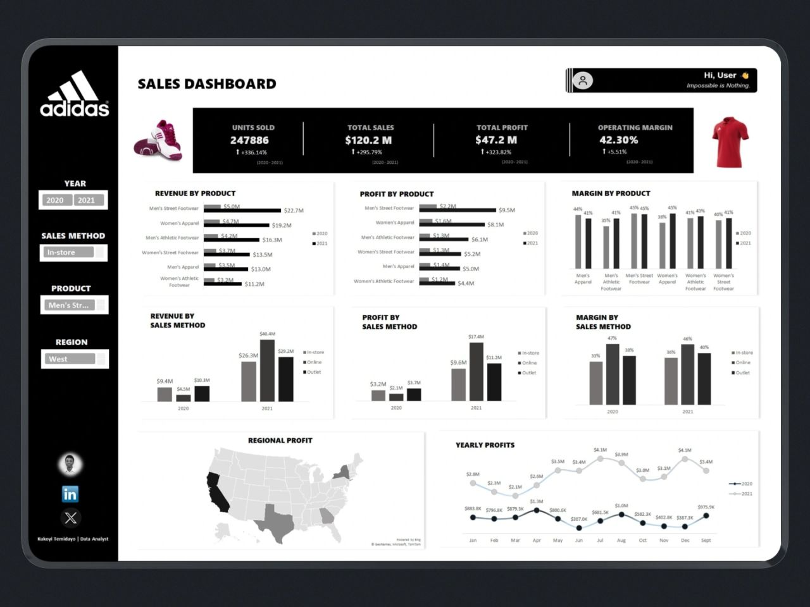
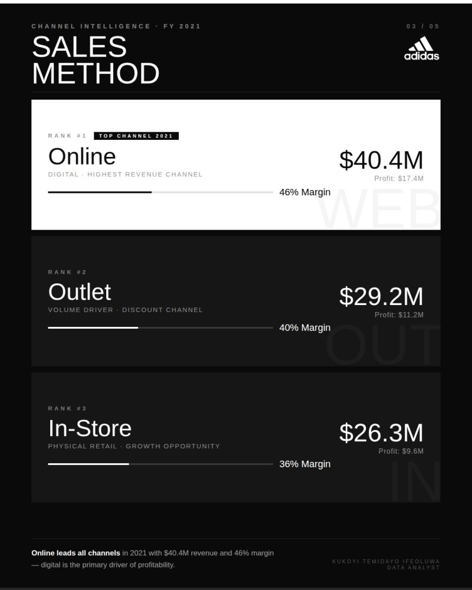
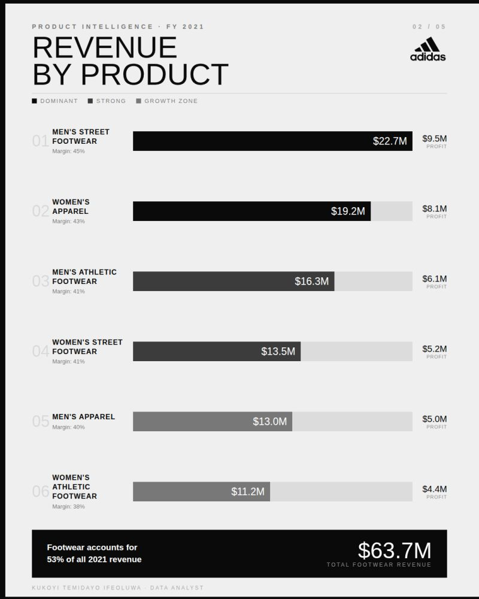
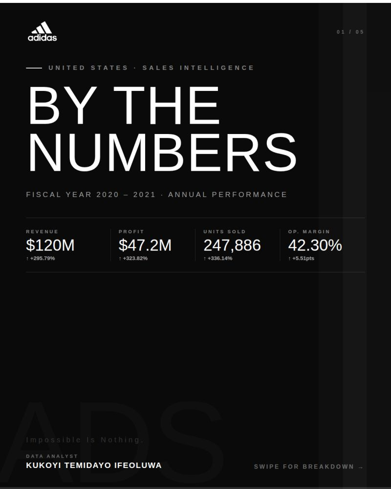
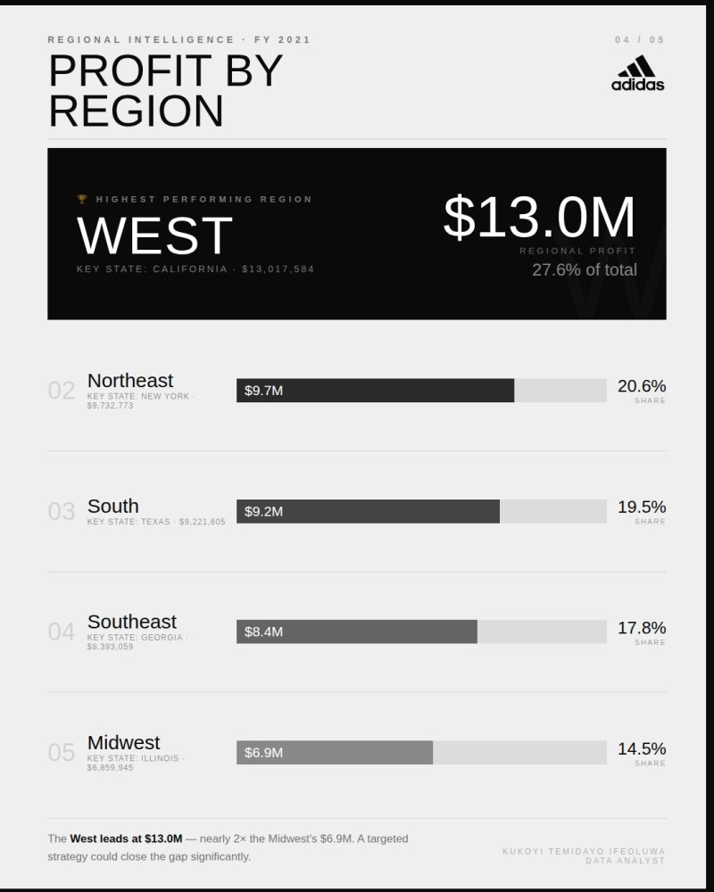

# Adidas Sales Performance: 2020–2021 Analysis

**Analyzing sales growth, profitability, product performance, and regional trends across Adidas products and sales channels in 2020 and 2021.**

An interactive analysis of Adidas sales performance across 2020–2021, exploring $120.2 million in sales, $47.2 million in profit, product-level performance, sales channels, operating margins, and regional trends to identify key business insights.

| | |
|---|---|
| **Field** | Data Analytics |
| **Period** | 2026 |
| **Tools** | Microsoft Excel |
| **Full case study** | [temidayokukoyi.vercel.app/work/adidas-sales-performance-analysis](https://temidayokukoyi.vercel.app/work/adidas-sales-performance-analysis) |

## The question

How did Adidas perform across products, sales channels, and regions between 2020 and 2021, and which areas contributed most to revenue and profit?

## Objective

The objective was to develop a sales performance dashboard that brings key commercial metrics into one place and makes comparisons across years, products, sales channels, and regions easier.

The analysis focuses on five areas:

- Overall business performance through units sold, sales, profit, and operating margin.
- Product-level revenue and profit comparisons.
- Sales channel performance across in-store, online, and outlet sales.
- Geographic differences in regional profitability.
- Changes in monthly profit and performance between 2020 and 2021.

## Context

Understanding sales performance requires more than tracking revenue alone. Businesses also need to understand profitability, operating margins, product-level differences, channel performance, and geographic patterns.

This project examines Adidas sales data for 2020 and 2021 through an interactive dashboard designed to compare key performance indicators, identify leading product categories, evaluate sales methods, and explore changes in profitability over time.

## The data

The project uses Adidas sales data covering 2020 and 2021. The dashboard organizes the information by product category, sales method, region, year, and month, alongside measures of units sold, total sales, total profit, and operating margin.

The dashboard supports comparisons across men's and women's product categories, in-store, online and outlet channels, and regional sales performance. The exact dataset row count, number of transactions, and complete list of source columns are not established by the available dashboard screenshot.

## Data sources

Adidas sales dataset covering 2020–2021.

## Method

The project uses descriptive sales and profitability analysis to compare Adidas business performance across 2020 and 2021.

The analysis is organized around key performance indicators, product-level comparisons, sales channel comparisons, regional profitability, and monthly profit trends. Revenue, profit, and operating margin are examined together to provide a broader view of performance than sales volume alone.

Interactive filters for year, sales method, product, and region allow users to explore different segments and compare results across the available dimensions.

The dashboard communicates the results through KPI cards, comparative bar charts, margin comparisons, a regional profitability map, and a monthly profit trend chart.

## Analysis process

1. Performance overview: Established a high-level view of units sold, total sales, total profit, and operating margin.

2. Product analysis: Compared revenue, profit, and margin across men's and women's footwear, apparel, and athletic footwear categories.

3. Sales channel analysis: Examined revenue, profit, and operating margin across in-store, online, and outlet channels for both years.

4. Regional analysis: Used geographic visualization to explore regional profitability and identify differences across markets.

5. Time-series analysis: Compared monthly profit patterns between 2020 and 2021 to examine changes in performance over time.

6. Interactive exploration: Incorporated year, sales method, product, and region filters to support more focused comparisons.

7. Business interpretation: Used the combined results to identify leading products, important sales channels, and areas that could benefit from further investigation.

## What the data showed

### $120.2M — Total sales reached $120.2 million

The dashboard reports approximately $120.2 million in total sales across the 2020–2021 period. This provides the overall revenue baseline for evaluating product performance, channel contribution, and changes between the two years. The dashboard also records 2,478,886 units sold, allowing overall sales performance to be considered alongside sales volume.

### $47.2M — Total profit reached $47.2 million

The dashboard reports approximately $47.2 million in total profit, alongside an operating margin of 42.30%. Considering profit and margin alongside revenue provides a more informative view of business performance than sales figures alone. The dashboard includes separate profit comparisons by product and sales method, making it possible to examine which segments contributed to overall profitability.

### $22.7M — Men's Street Footwear was the leading revenue category

Men's Street Footwear generated approximately $22.7 million in 2021 revenue, making it the highest-revenue product category shown in the product comparison. Women's Apparel followed at approximately $19.2 million. The product-level revenue and profit charts allow the leading categories to be compared across both years, helping distinguish revenue leaders from categories that perform differently on profit or margin.

### $40.4M — Online was the leading sales method by revenue in 2021

The sales-method comparison shows approximately $40.4 million in online revenue for 2021, compared with $26.3 million for in-store sales and $29.2 million for outlet sales. Online sales also recorded approximately $17.4 million in profit in 2021, compared with $9.6 million for in-store sales and $11.2 million for outlet sales. Online was therefore the leading channel in both displayed revenue and profit.

### 42.30% — The overall operating margin stood at 42.30%

The dashboard's headline operating margin is 42.30%. The product and channel comparisons show that margins varied across segments, reinforcing the importance of examining profitability at a more detailed level. The dashboard also displays margin comparisons for 2020 and 2021. These can help identify segments whose margin performance differs from the overall business figure.

### 2020–2021 — Monthly profit trends revealed differences between the two years

The monthly profit chart compares 2020 with 2021. The 2021 series generally sits above the 2020 series in the displayed months, showing stronger monthly profit values across much of the comparison period. The dashboard makes monthly changes visible, with 2021 profit reaching approximately $4.1 million in both July and December. The comparison helps identify stronger and weaker periods, although it does not establish what caused the changes.

## Challenges

A key analytical challenge in sales reporting is distinguishing high revenue from strong profitability. A product or channel may generate substantial sales without necessarily delivering the highest profit or operating margin.

Another challenge is presenting multiple dimensions of performance without overcrowding the dashboard. The project addresses this by separating the analysis into product performance, sales channel performance, regional profitability, and monthly trends, while keeping the main KPIs visible.

The dashboard also uses interactive filters to let users move from an overall view to more specific product, year, region, and channel comparisons.

## Recommendations

1. Maintain focus on leading product categories. Monitor Men's Street Footwear and Women's Apparel closely because they appear among the strongest revenue-generating categories in the dashboard.

2. Evaluate sales channels using both revenue and profit. Online sales led the displayed 2021 revenue and profit figures. Further analysis should examine channel costs, customer acquisition costs, and fulfillment expenses before making major resource-allocation decisions.

3. Monitor operating margins by segment. Review products and sales methods with lower margins to understand whether pricing, discounts, product costs, or operating expenses may be affecting profitability.

4. Use monthly trends for performance monitoring. Compare monthly results across years to identify periods that may warrant further investigation and to support planning for inventory, promotions, and sales activity.

5. Investigate regional differences. Examine regional profitability alongside sales volume and operating costs to understand why performance differs across markets.

6. Keep revenue and profitability reporting connected. Maintain a consistent view of units sold, revenue, profit, and margin so that business decisions consider multiple dimensions of performance rather than revenue alone.

## Outcome

**What came out of it**
An interactive Excel dashboard that puts units sold, revenue, profit and operating margin for 2020–2021 in one place, with filters for year, sales method, product and region.

**What it showed**
About $120.2 million in sales and $47.2 million in profit, at a 42.30% operating margin overall. Men's Street Footwear was the leading revenue category (about $22.7 million in 2021). Online was the strongest channel in 2021, at about $40.4 million against $26.3 million in-store and $29.2 million through outlets. Monthly profit in 2021 sat above 2020 in most months.

**What it supports**
The dashboard is built so that nobody reads revenue without margin beside it: the lower-margin segments sit on the same screen as the best sellers, which is where the pricing and discount questions start.

**Status**
An independent study on a public Adidas sales dataset. The figures are as reported in that dataset, not audited company results.

## In this repository

- `data/Adidas-US-Sales-Datasets.xlsx` — the workbook used for the analysis.
- `figures/` — 6 dashboard and report screenshots.

## Gallery

## Skills applied

Sales Analysis, Profitability Analysis, KPI Development, Year-over-Year Analysis, Product Performance Analysis, Sales Channel Analysis, Geographic Analysis, Data Visualization, Dashboard Design

---

**Temidayo Kukoyi** · Data analyst · [temidayokukoyi.vercel.app](https://temidayokukoyi.vercel.app) · [LinkedIn](https://www.linkedin.com/in/temidayo-kukoyi-5a59a7353)
